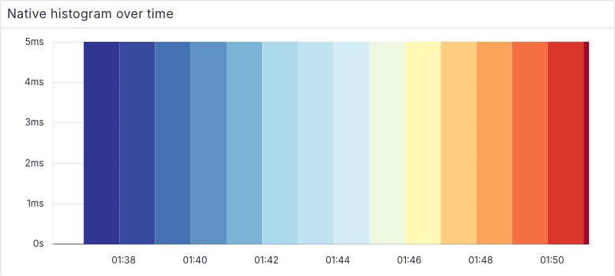
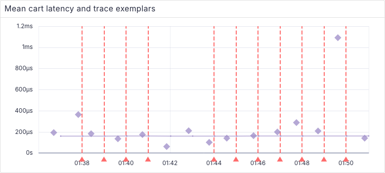
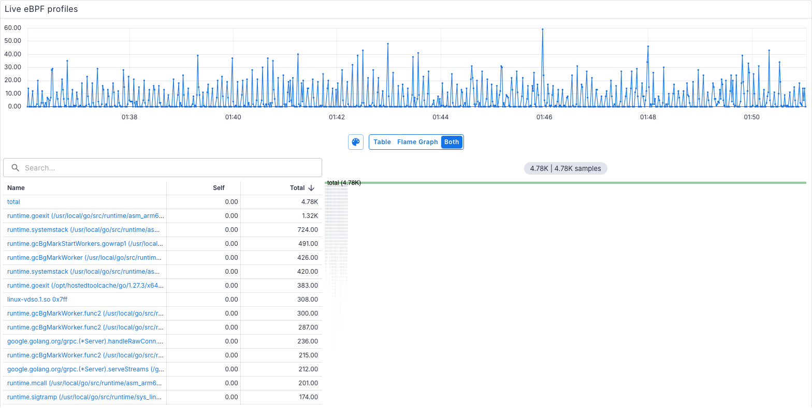

# Live validation results

Revalidated on 2026-10-31 on an Apple Silicon Mac with Docker Desktop. The actual runtime was moved to the system disk after the original external-volume reads stalled. Source worktrees and runtime data are separate; no repair or data deletion was performed on that volume.

## Versions

- OTel demo source: `33bd823107b1b38eaa88dd4ef625cc16d60475d4`.
- Collector: `0.160.0`; ClickHouse: `26.9.19.9`. Exact image digests: [images.json](./images.json).
- Perses host: `4f9350d788e9d7bfd8d852e36fd5b2d84305f1f5`.
- Shared runtime: `224c3187e04b5d694a96870bf27c826ec02d493f`, pinned before the later breaking query-context changes. Profile variables and infinite signal-query freshness remain enabled.
- Node: `24.22.1`; Go: `1.27.3` (the current `go.mod` requires 1.27.2, superseding the older contributor-guide toolchain line).

## SQL

241 variable, panel and annotation queries executed with a 2-second step and no SQL errors. All 12 native validation queries returned live data. The captured range was `2026-10-31 00:35:25` to `2026-10-31 00:50:25` UTC.

| Dashboard               | Queries | With rows | Empty |
|-------------------------|--------:|----------:|------:|
| agent-services          |      11 |        10 |     1 |
| apm-dashboard           |      30 |        22 |     8 |
| demo-dashboard          |      13 |        12 |     1 |
| events-by-name          |       5 |         5 |     0 |
| exemplars-dashboard     |       4 |         4 |     0 |
| linux-dashboard         |      38 |        31 |     7 |
| nginx-metrics           |       4 |         4 |     0 |
| opentelemetry-collector |      59 |        55 |     4 |
| postgresql-dashboard    |      25 |        21 |     4 |
| self-observability      |      30 |        22 |     8 |
| signal-validation       |      12 |        12 |     0 |
| spanmetrics-dashboard   |      10 |        10 |     0 |

Empty results are not counted as signal coverage. The remaining source-dashboard gaps include VCR token usage, service-specific HTTP/database instrumentation, unavailable VM filesystem/host metadata, legacy PostgreSQL/Quote exporter names, and error series that are not emitted without errors. The [setup documentation](./README.md#migration-differences) describes these limits and intentional panel adaptations.

## Browser and code checks

- 13 Playwright cases passed over the node's Tailscale IPv4 address: all panels on all 12 dashboards, native histograms, exemplar markers, trace search/detail, profile table/flame graph/timeline, and service-dependent queries.
- The interaction test verifies every signal, annotations and variables refetch a fixed absolute range despite infinite freshness, and profile SQL changes when zooming. The launcher also rejects a newer shared checkout before starting any process.
- The real shop and its recorded chatbot sample responses were exercised over Tailscale. Perses assets and datasource requests use the same browser origin; ClickHouse remains behind the backend proxy.
- All 32 repository unit-test tasks were rerun without cached results against the pinned shared package and passed. The final affected suites pass: ClickHouse 88 tests (6 separate synthetic live-fixture tests skipped) and HeatMapChart 7 tests.
- Six Python migration regression tests pass. The generated Compose configuration passes `docker compose config --quiet`, and the detached Perses launcher was used successfully.
- Repository lint, formatting and all 32 plugin type-check tasks pass, along with license headers and changed-document formatting/link checks.
- The pinned shared build and plugin-system type check pass; all 272 plugin-system tests pass.

Repository-wide TypeScript checking is green with the pinned shared commit. Metrics, logs and variable options use its `timeRange` contract; traces, profiles and annotations use `absoluteTimeRange`. ClickHouse maps those contracts into common SQL execution without runtime version detection. Package versions and dependency manifests remain unchanged.

The browser also logs existing React list-key/layout warnings from LogsTable and TimeSeriesTable; there were no uncaught runtime exceptions in the passing dashboard tests. No fresh metrics are fabricated for empty upstream panels. Summary metrics are unit-fixture coverage only because the official demo emits none.

## Rendered live data

## Private access and lifecycle

The running node's Tailscale address is `100.97.254.50`: Perses on port `18080`, Astronomy Shop on `18090`. The URLs were tested from that node using the Tailscale address; another device's tailnet ACL was not independently tested. HTTPS Serve was disabled on the tailnet, so direct private HTTP over Tailscale is used. No public exposure was configured.

The active runtime is `/private/tmp/perses-otel-demo/runtime`; PID files and logs are there. Follow the [launcher and stop instructions](./README.md#stop-or-restart) to manage it. The temporary source checkout contains the pushed branch; clone that branch to a permanent disk when retaining the setup across system cleanup or restart.
